# JUICE tutorial — from nothing to a result in an afternoon

This is the hands-on companion to the [README](../README.md). It walks through four things a new user
does: a chamber experiment, the same under UV lamps, field observations (three kinds of run), and a
parameter study. Every step
names what you click and what you should see. Nothing here needs access to the SAPHIR archive; the
examples run on typed conditions or on the synthetic tables shipped with JUICE. Budget: about
30 minutes for the install and the first run, two hours for the rest.

Throughout, a *step* is one of the five pages down the left of a window, and the *review panel* is the
right-hand column that always shows what the experiment contains and, under *Needs attention*, what is
still missing or doubtful. You can click an entry there: the step it belongs to opens and the field is
pointed out.

Everything here can also be done from Python: see [JUICE from code](juice_from_code.md). Each run folder
the windows prepare contains a `<name>_run.py` with the experiment written out as code.

---

## 0. Install and start (10 minutes)

```powershell
git clone https://github.com/GGkatzelis/JUICE.git
cd JUICE
python -m venv .venv
.venv\Scripts\activate
pip install -r requirements.txt
python -m juice.core.experiment_spec --selftest     # must end with 2/2 passed
python -m juice.tools.make_shortcut                  # the JUICE icon on the Desktop (Windows)
```

Python 3.11 or newer; Windows is the tested platform, macOS and Linux run the same code with
`source .venv/bin/activate`. The self-test rebuilds two reference experiments from their description
and compares them with the files the original IDL workflow wrote; if it passes, the installation is
complete. The first solver run compiles the kinetics kernel (Numba) and takes 15–20 s longer than later
runs — that is normal.

Double-click the **JUICE** icon. The first question is *Chamber experiment* or *Field observations*;
the chamber path then shows a small menu (new experiment, open one, new study, import a FACSIMILE
experiment, look at results). Each choice opens its own window; click the icon again for another.

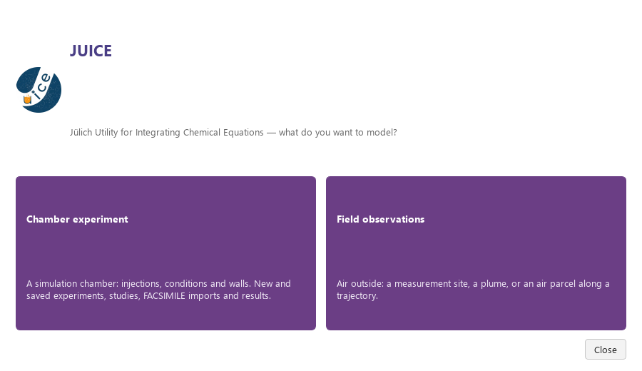

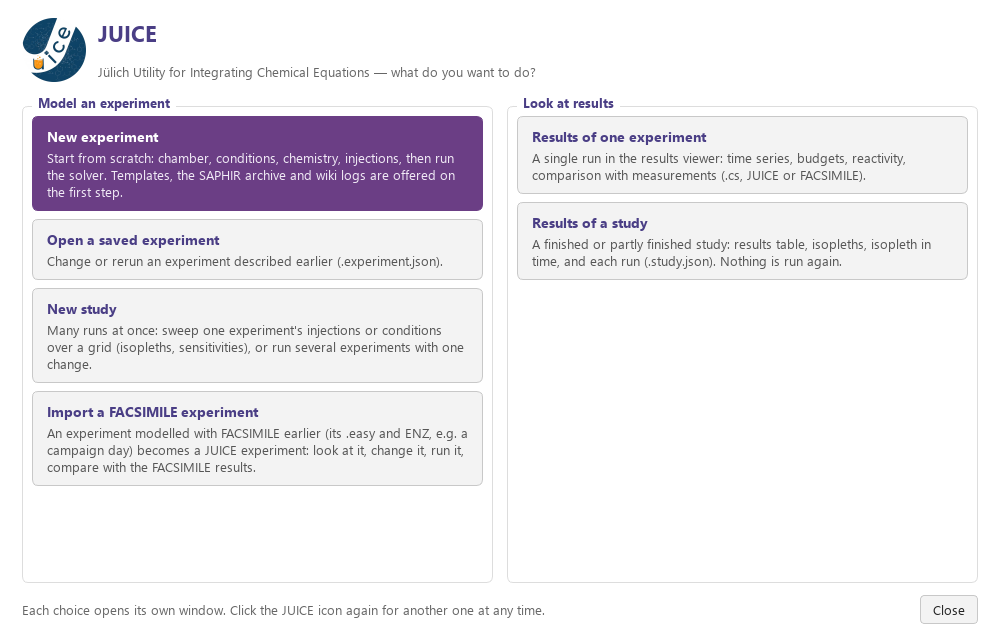

The screenshots in this tutorial are of exactly the experiments it describes, rendered by
`python docs/make_tutorial_screenshots.py`; folder paths are shown as `C:\JUICE\experiments`.

---

## 1. A chamber experiment: isoprene photo-oxidation in SAPHIR (20 minutes)

The classic SAPHIR daytime experiment: a humidified chamber, one VOC injected under the closed roof,
roof opened, ozone added. We take it from a template and use constant conditions, so that no archive
is needed.

### Step 1 — Experiment

1. *New experiment* from the menu, or `python -m juice.gui.juice_gui`.
2. Under *Template (optional)* choose **VOC photo-oxidation at low NOx**. The template fills the chamber
   effects and three injection slots (H2O, VOC, O3) and leaves the rest to you.
3. Name: `tutorial_isoprene`. Folder: anywhere you like — the experiment and everything it generates go
   into `<folder>\tutorial_isoprene\`.
4. Under *Where and when*: any date, e.g. `2024-07-09`, `07:00` to `16:00`, output step 60 s. The date
   sets the solar zenith angle for the clear-sky photolysis.
5. Chamber: **SAPHIR**. Conditions: choose **Manual — constant values, clear-sky photolysis** and type
   T = 298 K, p = 1013 hPa, H2O = 1 %, flow = 0.5 m³/h (the replenishment flow that dilutes the chamber).
6. Roof: open from `09:00` to `16:00`. Photolysis source: clear sky (the MCM parametrisation scaled to
   SAPHIR's roof transmission). With measured jNO2 you would give a conditions file instead (Sect. 5).

The review panel on the right now lists what goes into the input files and says for each condition
whether it is measured, constant or modelled; *Needs attention* says "No problems found".

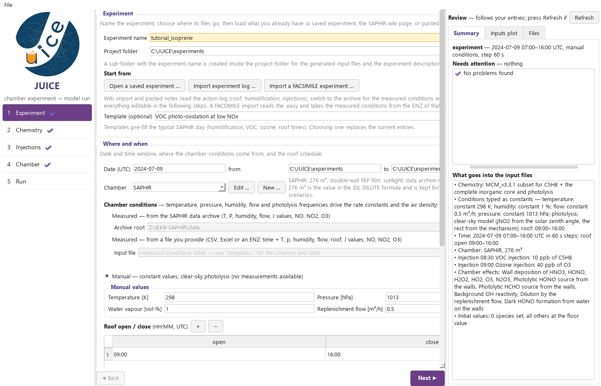

### Step 2 — Chemistry

1. Base mechanism: **MCM v3.3.1** (shipped; its checksums are verified at start). The same list offers
   the lumped mechanisms CRACMM 2, CRACMM 1 and RACM2 (used as a whole: no compounds to pick; MCM names such
   as `C5H8` still work for injections) and, greyed out, the mechanisms not converted yet. Add-ons such as
   the NOAA biomass-burning chemistry (furans, furfurals, guaiacol, syringol) are ticked below it.
2. Precursors: type `C5H8` (isoprene) and add it. JUICE extracts the MCM subset for this precursor
   (about 600 species) when the run is prepared; the review panel shows the size.
3. Leave add-ons and rate adjustments empty.

The *Find reactions* box on this step lists the reactions of any species of the subset — useful later
when you want to change a rate.

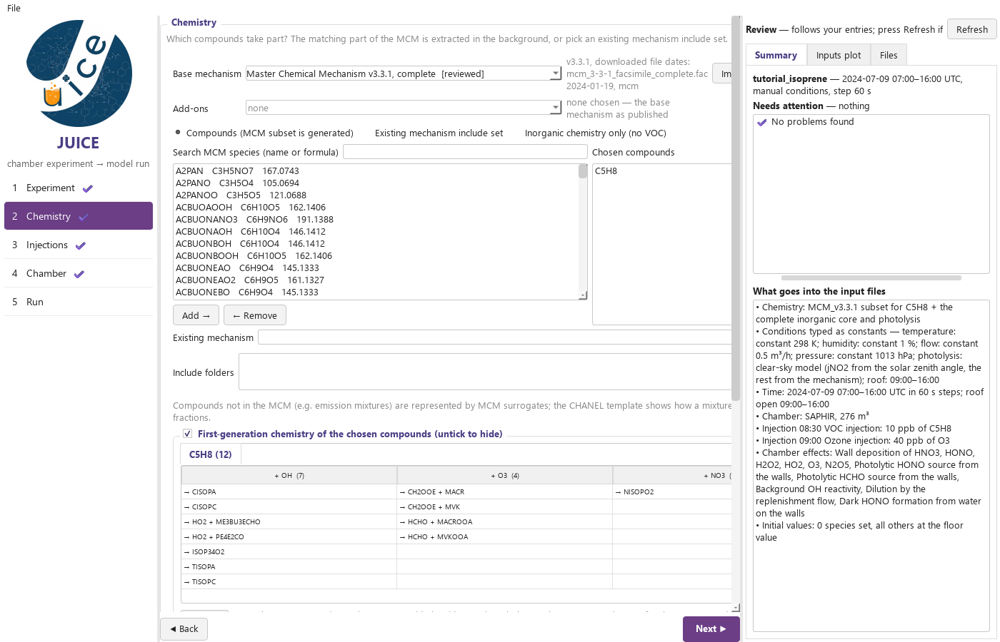

### Step 3 — Injections

The template brings three slots: humidification, a VOC and ozone. The humidity is already typed as a
condition on Step 1, so remove the humidification row and fill the other two:

| action | name | product | total | start |
|---|---|---|---|---|
| VOC injection | isoprene | `C5H8` | 10 ppb | 08:30 |
| Ozone injection | O3 | `O3` | 40 ppb | 09:00 |

The kOH column shows the OH reactivity each injection adds (24.6 s⁻¹ for 10 ppb of isoprene), and the
timeline below the table shows the pulses against the roof schedule.

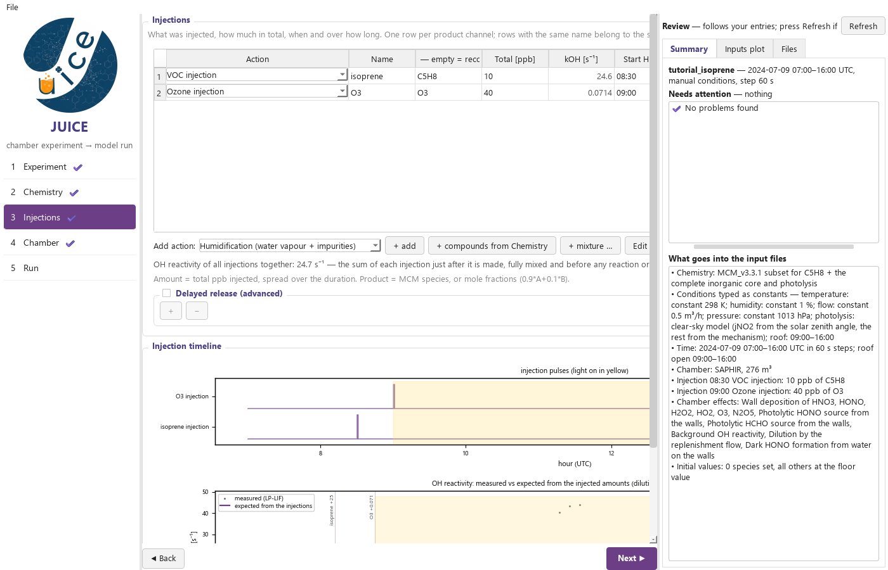

Amounts can be given in ppb, in µl of liquid by syringe (density and purity from the species
database), as a gas-syringe volume, or as a mass-flow-controller record; JUICE converts and shows the
ppb and the OH reactivity each injection adds. A mixture (several products with mole fractions) is one
injection too.

### Step 4 — Chamber

Everything is pre-set from the SAPHIR profile: wall deposition, the photolytic HONO and HCHO wall
sources, background reactivity, dilution with the flow you typed, dark HONO. Leave the defaults. (In a
dark ozonolysis experiment you would switch the photolytic sources off; the *Dark ozonolysis* template
does that.)

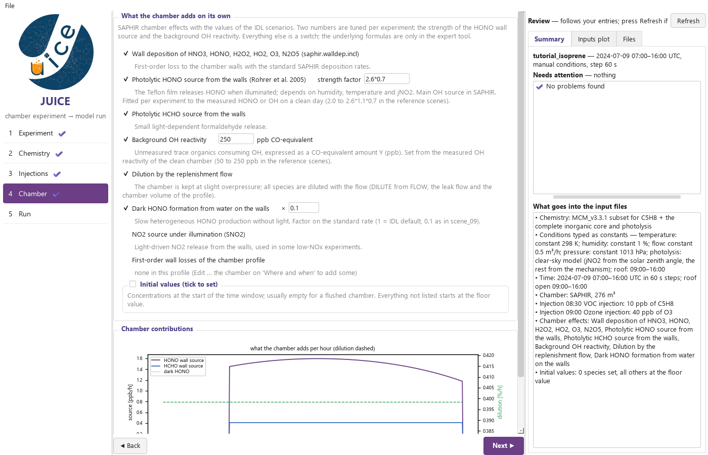

### Step 5 — Run

1. **Prepare** writes `tutorial_isoprene.enz` (conditions per output step), `tutorial_isoprene.easy`
   (the EASY input, as the IDL workflow wrote it) and the scenario `tutorial_isoprene.json`, and lists
   any include file it cannot find. All three can be opened from the review panel.
2. Solver profile: **fast** (default). *precise* is the tight-tolerance reference, *twostep* the
   Jacobian-free solver for very large mechanisms (Sect. 7).
3. **Run**. Under a minute on a laptop for this case, the first time including the kernel compilation;
   the log shows the solver's progress. The results viewer opens on `tutorial_isoprene.cs`.

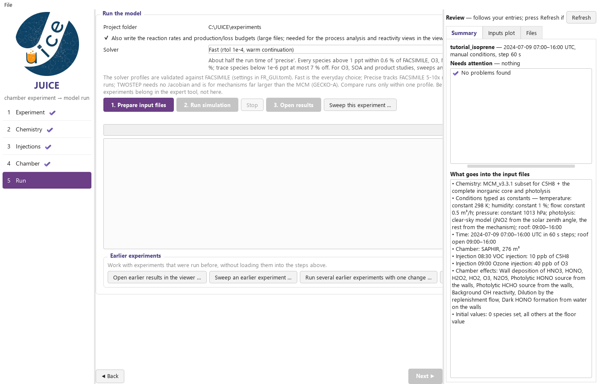

### What to look at in the results viewer

- **Overview**: the injected compounds, NOx and ozone, the radicals, HONO and CO, the OH reactivity and
  the chamber sources on one page, with the lit period shaded. On a SAPHIR day with archive access the
  measurements of that day are overlaid; for this invented day, untick *SAPHIR observations*.

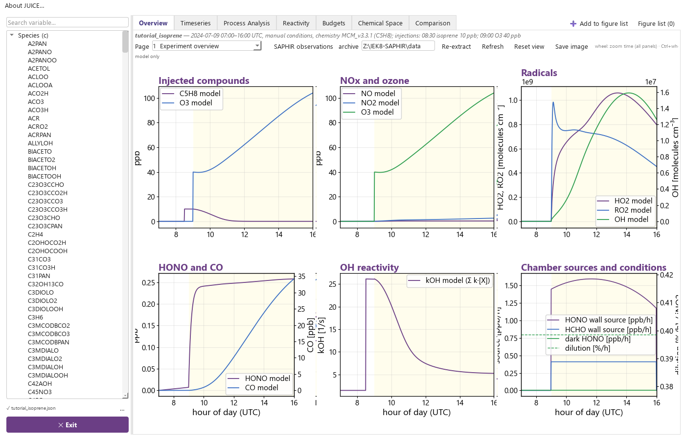

- **Timeseries**: any species or rate constant against time, in ppb or molecules cm⁻³; several on one
  axis; a measurements file (`<date>.observations.csv`) is overlaid when it lies next to the result.
  Pick species in the list on the left.

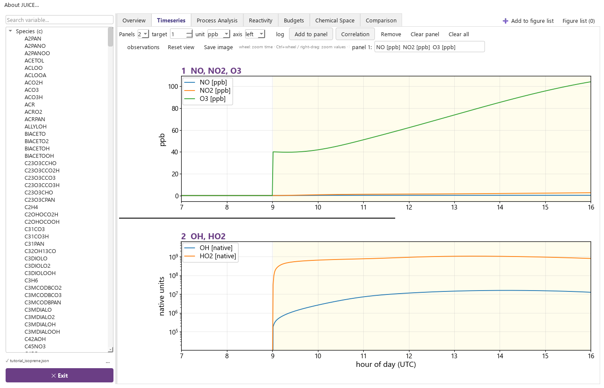

- **Process Analysis**: production and destruction of a species by reaction. Click OH: its sources are
  O¹D + H2O, HO2 + NO and HONO photolysis; its sinks HCHO, the chamber's background reactivity, NO2 and
  isoprene with its first products. The bars on the right are the time averages.

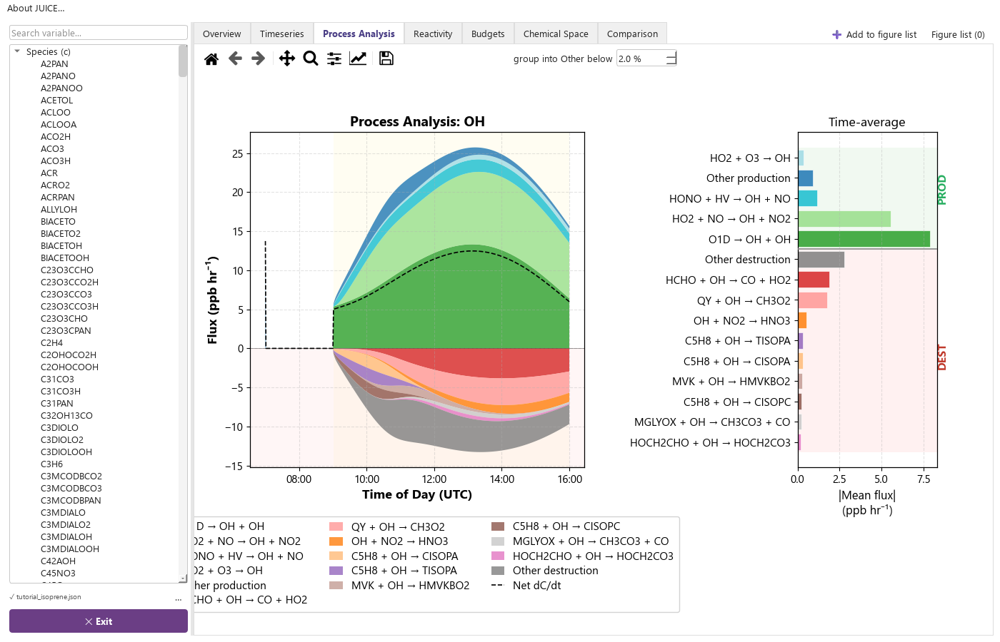

- **Reactivity**: the OH reactivity by species and over time.

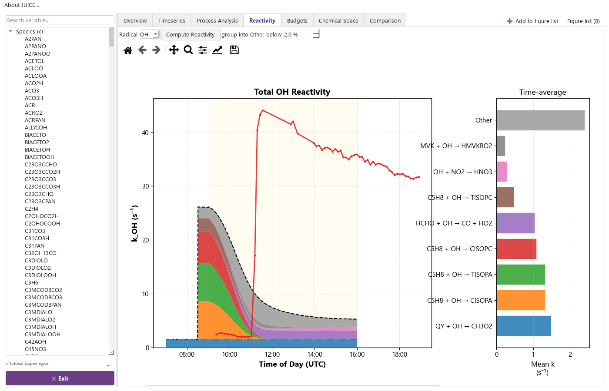

- **Budgets**: the Ox and radical budgets.

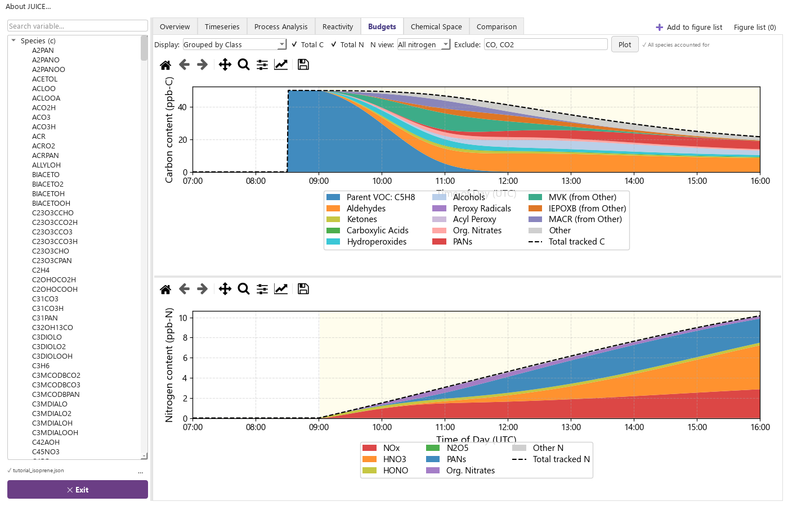

- **Chemical Space**: the products in volatility–oxidation-state space, by carbon number and as a
  mass-defect plot, at the time you select in the top-left panel; *Save video…* animates it over the day.

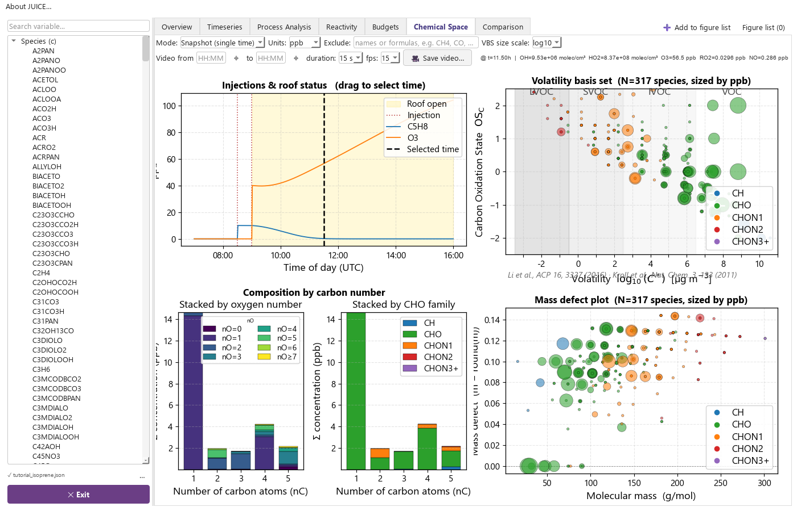

- Every figure has an *Add to figure list* button; the *Figure list* dock exports them as numbered SVG
  and PNG files with an index and a PowerPoint file.

Things to try now: in Step 4, switch the HONO wall source off and run again (the run folder keeps both
results; open the first `.cs` in a second viewer and compare OH). In Step 2, find `C5H8` with *Find
reactions* and scale the rate of its reaction with OH by 1.2 — the change is recorded in the EASY as a
`k[...]` line and in the provenance block of the file.

---

## 2. The same chemistry under UV lamps (10 minutes)

Indoor chambers have no roof and no sun. Start a new experiment from the template **UV-lamp chamber —
photooxidation under blacklights**:

1. Chamber: the generic 10 m³ lamp chamber (`generic_lamps`), or pick one of the 18 published chamber
   profiles (Caltech, UCR, CMU, GTEC, …; their numbers are from the literature and are marked
   unverified) or *New …* for your own. The profile holds the volume, leak flow, wall material, the
   lamps' jNO2 at full power and the lamp spectrum.
2. Lights schedule instead of roof times: the template switches the lamps on from `09:00` to `13:00` in
   an `08:00`–`14:00` window. A `lights` column in a conditions file may be 0–1 for dimmed lamps.
3. Photolysis: jNO2 from the profile × the lights schedule; every other J follows from the lamp spectrum
   and the σ·φ table (`J<n> = jNO2 × ∫σφF dλ / ∫σφF dλ(NO2)`). The generated EASY states each ratio next
   to the clear-sky one, so you can see what the lamps do to j(O¹D) or j(HCHO).
4. The OH source: blacklights give little j(O¹D), so the template starts with 1 ppm H2O2 as an initial
   value (Step 4, *Initial values*). HONO or CH3ONO are the alternatives, the latter needs an add-on
   mechanism.
5. Chemistry and injections as before; the screenshots use propene (`C3H6`, 50 ppb at 08:30) after
   20 ppb of NO at 08:15. Then Run. The review panel lists the lamp J ratios next to the clear-sky ones,
   e.g. j(O¹D)/j(NO2) = 0.0047 under these lamps against 0.0033 under the sun.

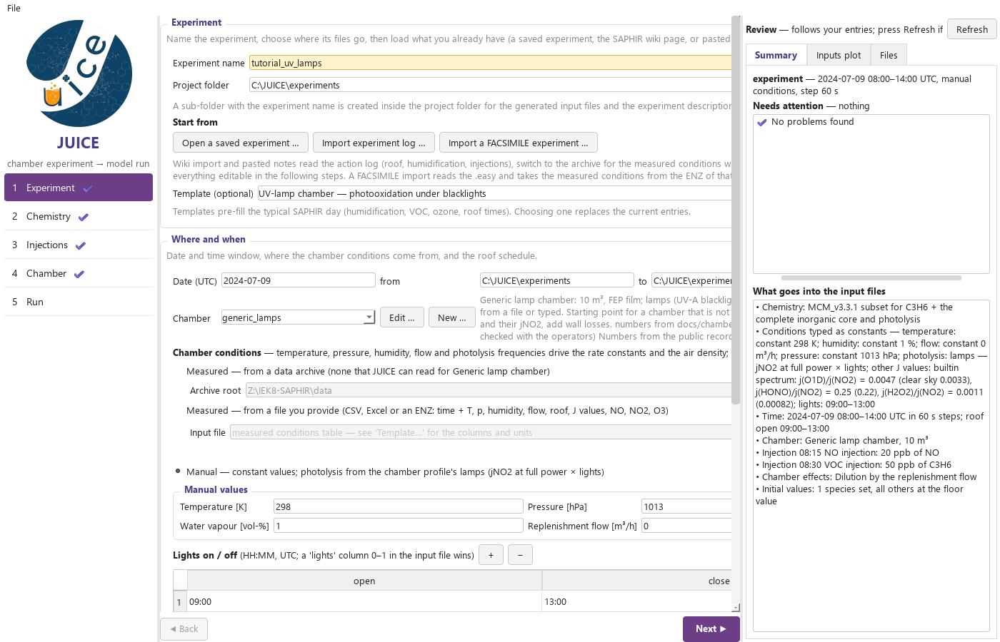

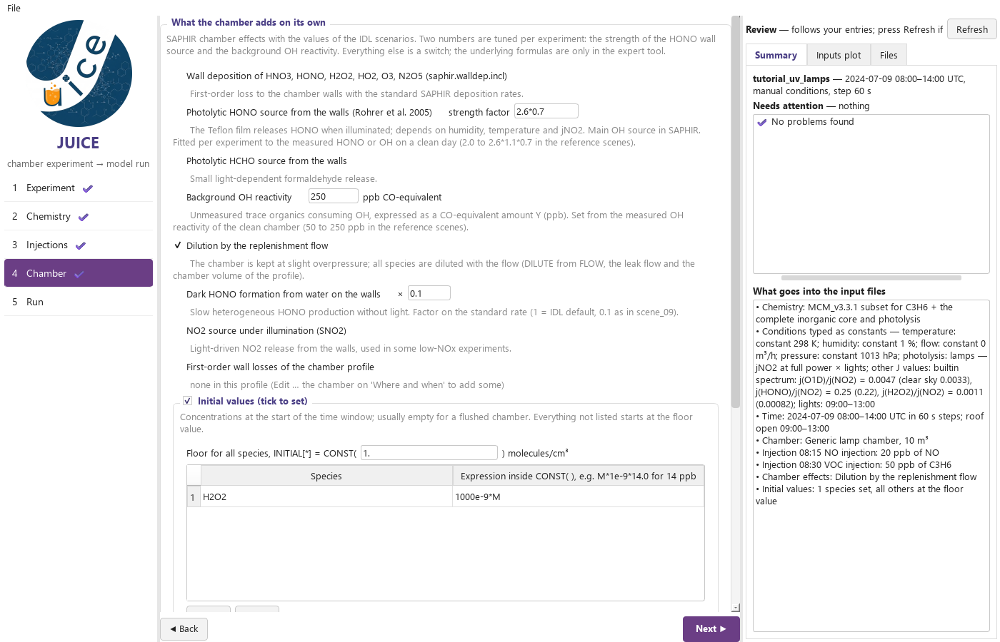

`python -m juice.tools.check_lamp_chamber` runs a fixed experiment of this kind headless and checks it against
physics that must hold (every J zero in the dark, the dilution rate, the H2O2 loss) — the gate for the
lamp code.

---

## 3. Field observations (45 minutes)

A field case has no chamber. Instead of the chamber archive JUICE reads **one input table** of what was
measured or prescribed along the way, and the chemistry runs in an air mass that is held to
measurements, diluted towards background air, or fed by emissions. The window has the same five steps
as the chamber window. Everything the field adds is written as ordinary EASY statements, so a field
case runs in FACSIMILE as well (Sect. 3.7).

JUICE ships three synthetic examples in `examples/field/`, one per kind of run. Their numbers are
invented (plausible for Los Angeles in August); nothing in them was measured. This section walks
through all three.

### 3.1 Which kind of run?

| kind of run | what the model does | typical question | example |
|---|---|---|---|
| **Constrained site** | measured species are held to the table; radicals and products run free with a generic lifetime; the first day is repeated as spin-up | radical budget, ozone production rate, closure of HCHO or PAN | `site_day` |
| **Plume or transect** | the air is diluted towards background air at a rate from the table, a constant, or the decay of a tracer | how a plume ages downwind | `plume_ageing` |
| **Lagrangian air parcel** | emissions E/(h·A) enter a parcel whose boundary layer grows (dilution towards background), with deposition | does the inventory reproduce what arrives at the site? NOx/VOC sensitivity | `la_parcel` |

The kind of run sets sensible defaults (for example the dilution source); every choice can still be
changed on the steps.

### 3.2 The input table

One row per time, in UTC, as CSV or Excel. Lines starting with `#` are comments; the examples use them
to explain every column. *Write a template for this kind of run…* on the first step writes an empty
table with the columns the chosen kind of run needs.

| column | meaning | units |
|---|---|---|
| `time` | `YYYY-MM-DD HH:MM`, or `HH:MM` / hours of day with the case's date, or seconds | UTC |
| `lat`, `lon` | position per row (a trajectory) or once in the case (a site) | degrees |
| `T`, `p`, `RH` or `H2O` | air temperature, pressure, humidity | K, hPa, %, vol-% (°C and Pa are recognised) |
| `h` | boundary-layer height; needed for emissions per area, deposition velocities and boundary-layer dilution | m |
| `kdil` | first-order dilution rate, when dilution comes from the table | 1/s |
| `jNO2`, `jO1D`, `jHONO`, … | measured photolysis frequencies; the mechanism's clear-sky values are scaled by `jNO2` | 1/s |
| `E_<species> [unit]` | emission | ppb/s, molec/cm³/s, molec/cm²/s, mol/km²/s, mol/km²/h, mol/s, molec/s |
| `B_<species> [unit]` | background the air is diluted towards | ppb, ppt, ppm, molec/cm³ |
| `C_<species> [unit]` | measurement the species is **held** to | same |
| `O_<species> [unit]` | measurement only **compared** with the model, never fed in | same |

Species names are those of the mechanism (MCM: `C5H8` isoprene, `TOLUENE`, `C2H5OH` ethanol, …).
Emissions in mol/s or molec/s need the footprint area of the case. Emissions are held from one row to
the next; everything else is interpolated to the output step (60 s by default). A held species takes
the value read at the start of each output step, as FACSIMILE does.

**From your own measurements.** Average to the time resolution you want the model to follow (10–30 min
is typical), convert times to UTC, rename the measured species to mechanism names with the right
prefix, and keep gaps as empty cells: the review panel counts empty rows per species. Decide per
species whether it constrains the model (`C_`) or tests it (`O_`): a species cannot be both, and a
product you want to evaluate must not be held.

### 3.3 Walkthrough 1: a constrained site (`site_day`)

1. JUICE icon → *Field observations* → *New field case*, or `python -m juice.gui.field_window`.
2. Step 1, *Field case*: choose `site_day` under *Examples* and click **Load an example**. The case and
   its table are copied into your project folder; the copy is yours to change. The table has 49 rows
   over one day with `C_NO`, `C_NO2`, `C_O3`, `C_CO`, `C_C5H8` and `C_TOLUENE` held, and `O_HCHO` observed
   only.
3. Kind of run: *Constrained site*, one spin-up day, a generic 6-h lifetime for everything that is
   neither held nor explicitly deposited. The review panel shows the conditions the model will see and
   counts the table: 49 rows over 24 h, six species held, one observed for comparison.


4. Step 2, *Chemistry*: the MCM subset for isoprene and toluene, chosen as in the chamber window.

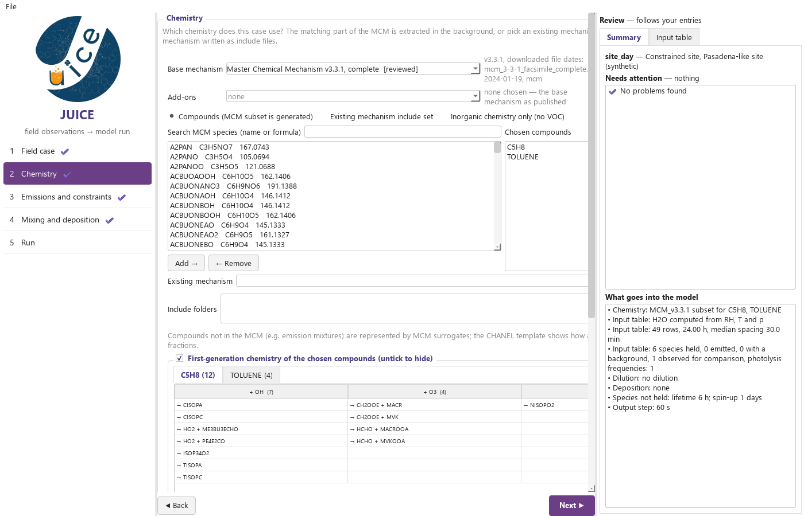

5. Step 3, *Emissions and constraints*: the held species with their ranges, the observed one (HCHO), and
   the constraints against time; nothing is emitted at a constrained site.

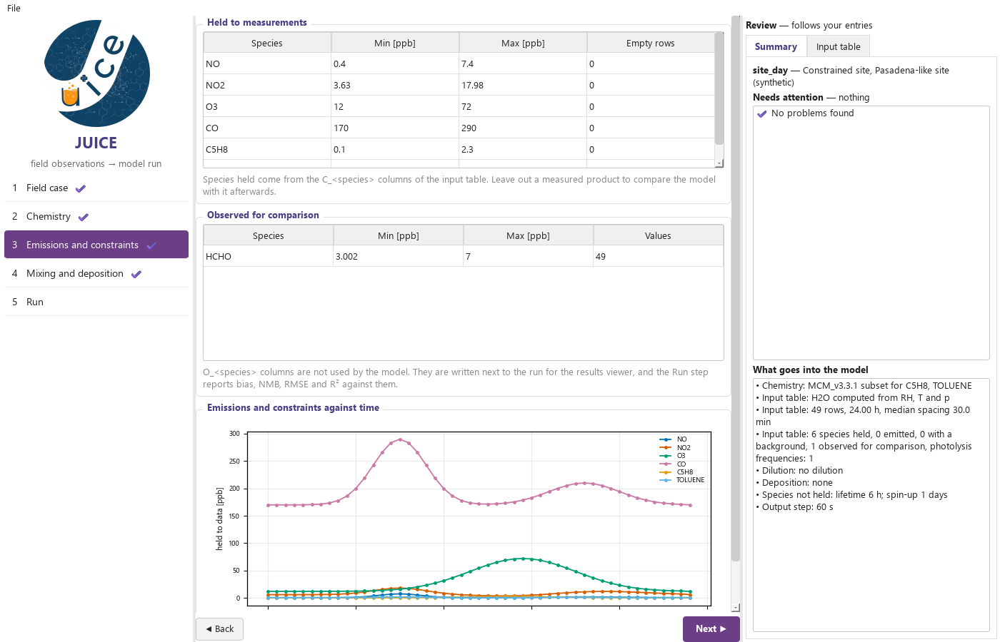

6. Step 4, *Mixing and deposition*: no dilution (the held species carry the mixing), deposition
   velocities for O3 and HNO3 if you want them.

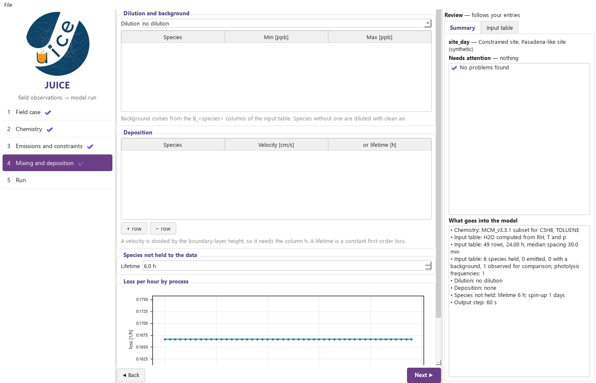

7. Step 5, **Run**. About two minutes on a laptop: 48 model hours (spin-up and the day) of 3 228
   reactions.

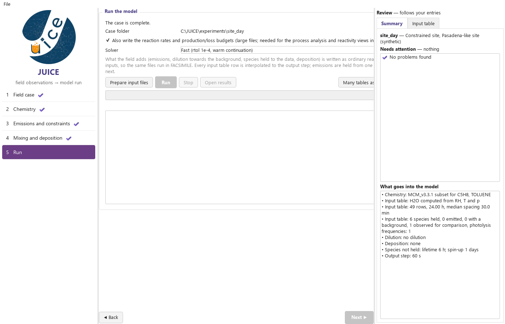

**Reading the result.** The log ends with the skill table against every `O_` column, also written as
`site_day_skill.csv`:

```
model vs observations (ppb): species  n  obs mean  model mean  bias  NMB  RMSE  R²
  HCHO         49        4.6       5.58   0.978 +21.2%    3.22  0.45
```

In the viewer, put HCHO on a Timeseries panel: the model is the line, the measurement the dots. The
time axis counts hours from midnight of the **spin-up day**, so the measured day runs from hour 24 on
(the observations start at 07:00, hour 31). Judge the model only there; the first day exists to bring
the unconstrained species to a periodic state.

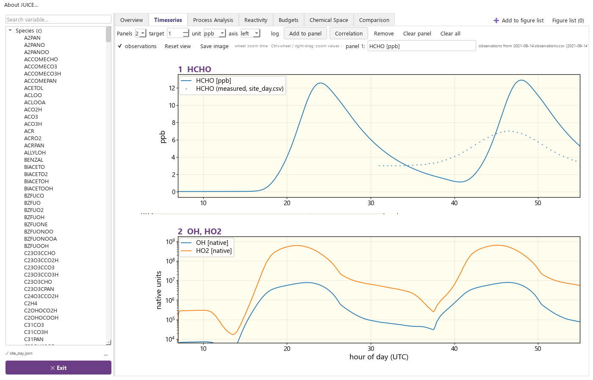

Here the model overshoots the afternoon HCHO, which is what a constrained-site run is for: it points
to missing HCHO loss, an overestimated source, or a lifetime that is too long. Things to try:

- Rename `O_HCHO` to `C_HCHO` in the table and run again: HCHO is now held, and *Process Analysis* for
  OH shows what the constraint changes in the radical budget.
- Change the generic lifetime on Step 1 from 6 h to 24 h and compare the HCHO overshoot.

### 3.4 Walkthrough 2: a plume (`plume_ageing`)

Three hours downwind of a source. The plume is the case's **initial values** (Step 4: 20 ppb NO, 30 ppb
NO2, 600 ppb CO, …); the table gives the background it mixes with (`B_` columns) and a tracer.

1. Load the example `plume_ageing`. Kind of run: *Plume or transect*, 19 rows over 3 h.

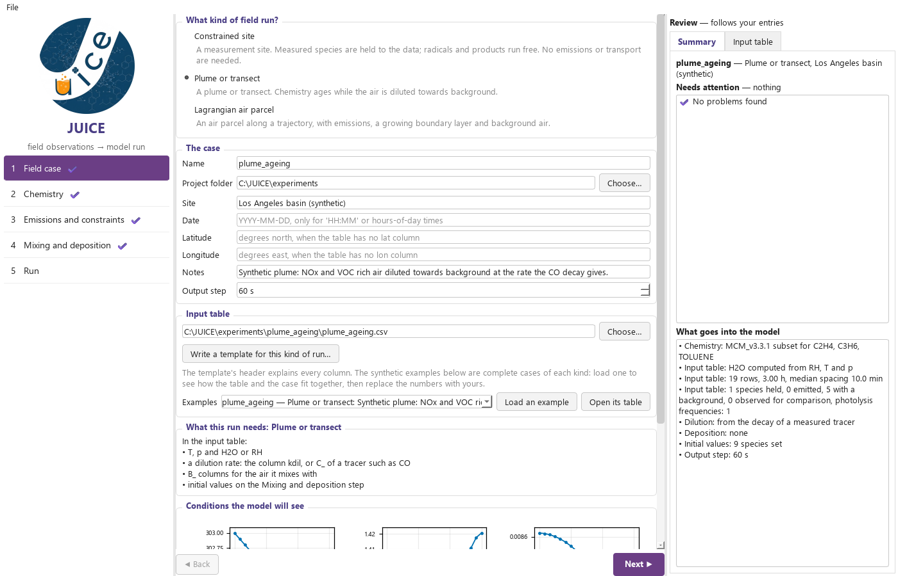

2. Step 4, *Mixing and deposition*: dilution **from the decay of a measured tracer**, CO. The tracer is
   held to its `C_CO` column, and its excess over the background gives the rate,
   k_dil = −d ln(CO − CO_background)/dt, so the measured CO decay sets how fast every species mixes
   towards its `B_` value. Species without a `B_` column are diluted with clean air. Other sources of
   the rate: a `kdil` column, or one constant.

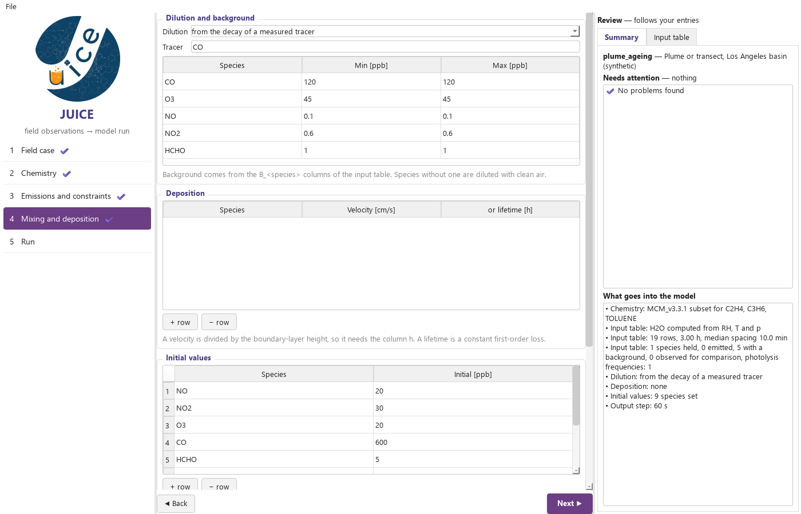

3. Run (about a minute). CO follows its measured decay from 600 to 284 ppb; NOx falls from 50 to
   15 ppb as the plume dilutes and reacts; O3 rises from 20 to 42 ppb, from mixing with the 45 ppb
   background and from photochemistry. Switch the dilution off on Step 4 and run again to separate the
   two: what remains is the chemistry alone.

### 3.5 Walkthrough 3: a Lagrangian air parcel (`la_parcel`)

A 4-h sea-breeze trajectory from Santa Monica Bay to Pasadena, the kind of run used by Stockwell et al.
(2025) for the Los Angeles basin.

1. Load the example `la_parcel`. Kind of run: *Lagrangian air parcel*. The table has a position per row
   (`lat`, `lon`), the boundary-layer height `h`, and emissions of NO, NO2, CO, isoprene, toluene and
   ethanol in mol/s.

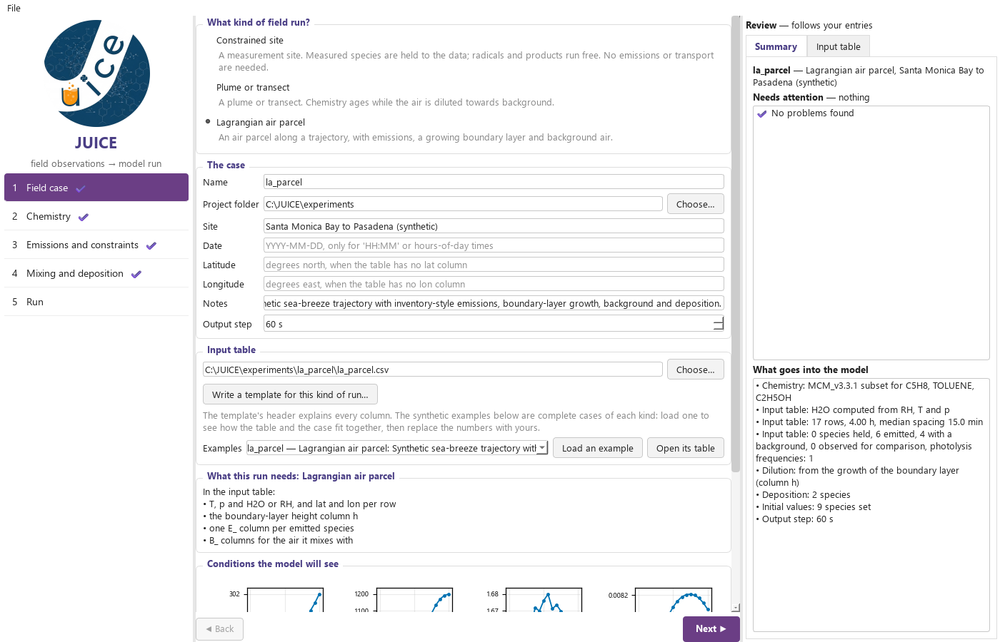

2. Step 3, *Emissions and constraints*: emissions in mol/s over a footprint of 64 km² (8 × 8 km, the
   grid cell of an inventory). JUICE converts them to a volume source E/(h·A) in the parcel, so the
   same emission counts less when the boundary layer is deep. The plot shows the result in molec/cm³/s.

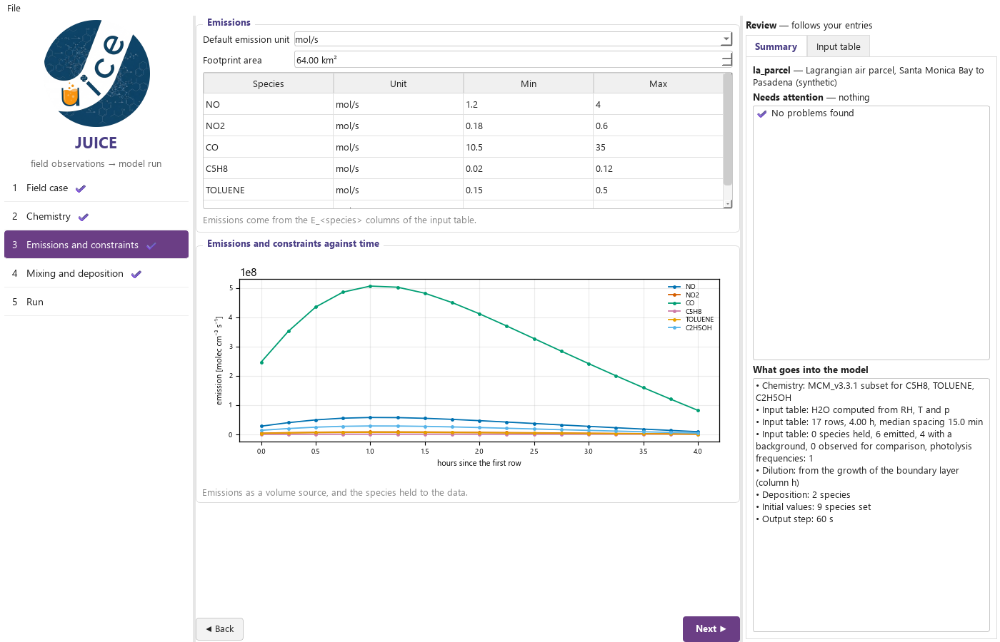

3. Step 4, *Mixing and deposition*: dilution **from the growth of the boundary layer**: while `h` grows,
   the parcel takes in background air at the rate d ln h/dt (when the layer collapses, a set collapse
   rate applies). Deposition velocities for O3 and HNO3 are divided by `h` as well.
4. Run, and compare what arrives with the `site_day` case: that is the question a Lagrangian run asks
   of an emission inventory.

### 3.6 From one case to many

*Many tables as a study…* on the Run step runs one case over a folder of input tables (one per day or
per trajectory) and, optionally, over NOx and VOC emission factors, in the study window (Sect. 4).
`python -m juice.core.study_runner <name>.study.json` runs it from the command line. Without the window:
`python -m juice.core.field_scenario <case>.field.json --run` prepares and runs one case.

### 3.7 What a field case writes

Every field term is an ordinary EASY statement, so the run folder works in FACSIMILE unchanged:

| term | EASY |
|---|---|
| emission | `QE_X = INPUT(QE_X)` with the reaction `QE_X --> X` |
| dilution | the mechanism's `X + DIL -->` reactions with `DILUTE = CONST(KDIL + …)` |
| background | `B_X --> X` with `k = CONST(KDIL*1e-9*M)` |
| held species | `X = CONST(C_X*1e-9*M)` |
| deposition | `X -->` with its first-order rate |

The ENZ has one row per output step; pressure may vary along the path (`P = INPUT(P)`).

---

## 4. A study: an ozone isopleth (15 minutes, plus the runs)

A study runs saved experiments with one consistent change, or sweeps one or two axes.

1. Menu → *New study*, or File → *Study…* in the experiment window, or `python -m juice.gui.study_window`.
2. Base experiment: `tutorial_isoprene.experiment.json`.
3. Axes. Axis 1: *+ initial value…* → NO, values `log 0.1 20 6` (six log-spaced values from 0.1 to
   20 ppb). Axis 2: in the table, set *Vary on* of the row *All VOC injections together* to *Axis 2*,
   values `log 0.5 4 6` (× the experiment's 10 ppb of isoprene). The line under each axis repeats what
   will be varied, and the count below the table says 36 runs.

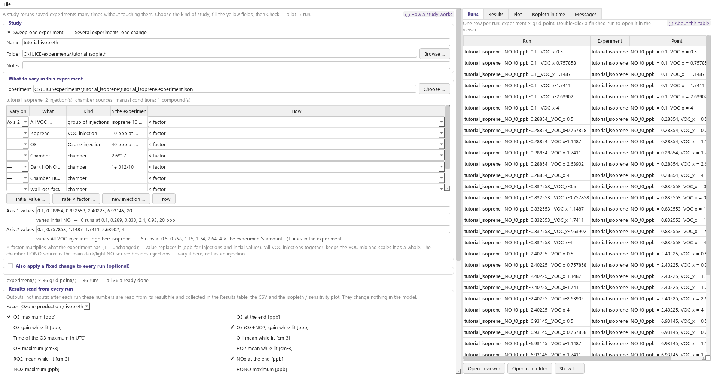

4. *Run pilot, then estimate* runs the first case alone, measures it and asks before starting the other
   35 (on four workers about 8 min for this case).
5. *Runs* lists every run with its state; double-click a finished one to open it in the viewer.
   *Results* is the metrics table (O3 maximum, Ox gain while lit, OH mean, NOx at the end, …) and the
   CSV behind it. *Plot* draws the isopleth of the chosen metric over the two axes, with the ozone ridge
   (the NO of maximum ozone production at each isoprene amount), the VOC-sensitive region hatched and
   the radical-budget indicator dotted. Each run has its own folder under `<study>/runs/` with a
   provenance block in its EASY; the base experiment is never modified.

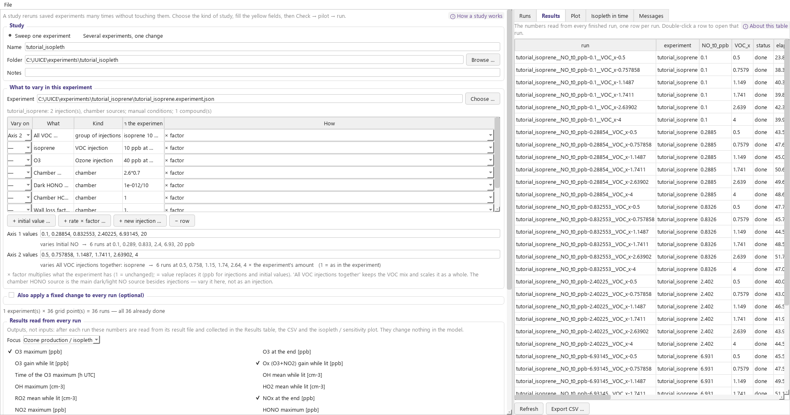

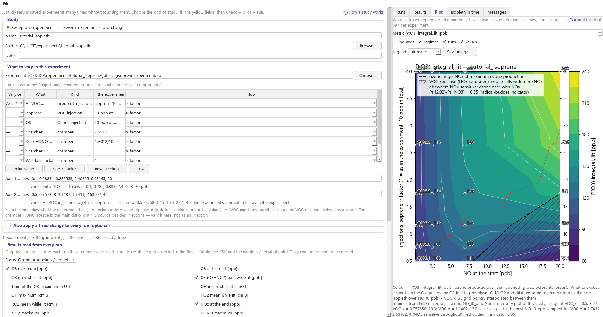

Headless: `python -m juice.core.study_runner <name>.study.json --workers 4 --yes`.

---

## 5. Your own measured conditions

For a real chamber day without archive access choose **Measured — from a file you provide** on
Step 1 (the template *SAPHIR — measured conditions from a file* starts such an experiment).
*Template …* writes a CSV with the recognised columns: time, T, p, H2O or RH, flow, roof or lights,
jNO2 and other J values, NO/NO2/O3. Give jNO2 whenever you have it: every J you do not measure is then
modelled from it. Unknown columns are ignored and listed; missing ones fall back to the typed constants
and *Needs attention* says so.

Measurements for comparison in the viewer are a second file, `<date>.observations.csv`
(`hour_utc,key,value`) next to the result.

---

## 6. Experiments set up for FACSIMILE

*Import a FACSIMILE experiment* (menu, Step 1, or `python -m juice.gui.juice_gui path\to\<name>.easy`) reads an
EASY file and the ENZ it names back into an experiment description, regenerates both and compares them
statement by statement with the originals; what did not round-trip is listed under *Needs attention*.
When the FACSIMILE result (`<name>.cs`) lies next to the inputs, the Run step offers **Compare with
FACSIMILE** after the run.

---

## 7. Large mechanisms: GECKO-A and the twostep profile

A GECKO-A generator output folder (`dictionary.out`, `reactionswithcom.dum`, `pvap.nan.dat`, …) is
imported on the Chemistry step with *Import GECKO-A output…* (or `python -m juice.importers.gecko_import <folder>
--id GECKOA_toluene --voc TOLUENE`). It becomes a base mechanism like the MCM: choose it, decide on the
inorganic core (GECKO-A's own, or the MCM core for a like-for-like comparison) and whether the
gas–particle–wall partitioning include is loaded, and set up the experiment as usual. Imported
mechanisms are not in git; regenerate them from the generator output.

For mechanisms of 10⁵ species and more choose the **twostep** profile on the Run step: Verwer's
TWOSTEP needs no Jacobian, so its cost grows with the number of reactions rather than with the Jacobian
factorisation (a toluene mechanism of 118 000 species runs a 24-h day in half an hour on a laptop;
α-pinene with 1.45 million reactions six hours in 49 min). Two things to know: species below about
3 000 molecules cm⁻³ are numerical zero in its output, and the result file of such a run is gigabytes —
pick the species you need in the viewer rather than plotting all of them.

---

## 8. If something looks wrong

| symptom | where to look |
|---|---|
| *Needs attention* lists a missing include | Chemistry step → include folders: add the folder the file lives in |
| OH of 10⁸–10⁹ molecules cm⁻³, HONO near zero | the mechanism has no physics lines (`M`, `O2`, `N2`): an MCM include set brings them in its `.saphir.incl`, a GECKO-A base in `geckoa.physics.incl` — check both are loaded |
| J values of 1 s⁻¹ or ozone stuck at 1 ppb | a photolysis name is used that no include defines (an undefined name evaluates as 1, not 0); the review panel's photolysis entry shows the source of every J |
| the run is slow for a small mechanism | the first run compiles the kernel (15–20 s); a loaded machine; or rtol 1e-6 with a cold restart (*precise*) on a long day |
| a species at a few molecules cm⁻³ looks noisy | below the absolute tolerance floor (100 molecules cm⁻³ in fast/precise, 30× that in twostep); not chemistry |
| results differ from an earlier run by ~0.5 % | different solver profiles; compare runs within one profile |

The gates the developers run after any change are `python -m juice.core.experiment_spec --selftest`,
`python -m juice.tools.check_easy_roundtrip`, `python -m juice.tools.check_lamp_chamber` and `python -m juice.tools.run_benchmark` (JUICE
against FACSIMILE on nine reference experiments); `python -m pytest` runs the unit tests.
